# icm-dbs-tractography

A pipeline that goes from raw diffusion MRI to **edge-level structural connectivity of the stimulated volume** for deep brain stimulation (DBS) patients, plus a small leave-one-patient-out prediction on top. I built it on the open-DBS dataset (ScienceDB 26302: Parkinson's patients with subthalamic electrodes, raw MRI/CT and the authors' Lead-DBS results), but it is meant to be reusable on another cohort.

The edge-connectome idea follows the Presidio work (per-VTA connectivity between brain regions, SIFT2-weighted).

## What it does, per subject

| Step | Script | What |
|---|---|---|
| 01 | `01_import_qc.sh` | import DWI, check shells and bvecs |
| 02 | `02_denoise.sh` | MP-PCA denoising and Gibbs unringing |
| 03 | `03b_synb0.sh`, `03b_eddy_topup.sh` | Synb0-DISCO synthetic undistorted b0, topup, eddy |
| 04-05 | `04_bias_mask.sh`, `05a_ref.sh`, `05_coreg.sh` | bias correction, brain mask, DWI to T1 rigid coregistration |
| 06 | `06_fod.sh` | multi-shell CSD (dhollander responses), mtnormalise |
| 07 | `07_5tt.sh`, `07b_stn.sh` | 5TT tissues, with the STN added as subcortical GM |
| 08 | `08_tracto.sh` | iFOD2 + ACT, 10M streamlines, SIFT2 |
| 09 | `09_rois_cohort.sh`, `09c_bundles.sh` | native-space ROIs (cortex, STN, GPi, VTA...) and DBS bundles (hyperdirect, STN-GPi, CST, VTA bundles) |
| 11 | `11_edges.sh` | **388-node parcellation (Glasser 360 + Tian subcortex + STN) in native space, SIFT2 connectome of the whole brain and of each VTA** (75,078 edges, upper triangle) |

`run_subject.sh` chains everything for one subject (resumable, automatic sanity checks instead of visual gates, heavy intermediates deleted at the end, a `summary.tsv` per subject). `run_cohort.sh` runs a list of subjects, optionally in parallel.

Prediction (`12_build_master.py`, `13_loso_predict.py`): builds the VTA x edges matrix with clinical labels, then L1 logistic regression and ridge, evaluated leave-one-patient-out with a patient-level permutation test.

## The pipeline in pictures

These are the QC figures I looked at for the first subject before trusting each step. Legends in some of them are in French, sorry.

**1. Import and QC.** First thing I check is the gradient table. A flipped axis doesn't crash anything, it just gives wrong tracts, so it's the cheapest check with the biggest payoff.

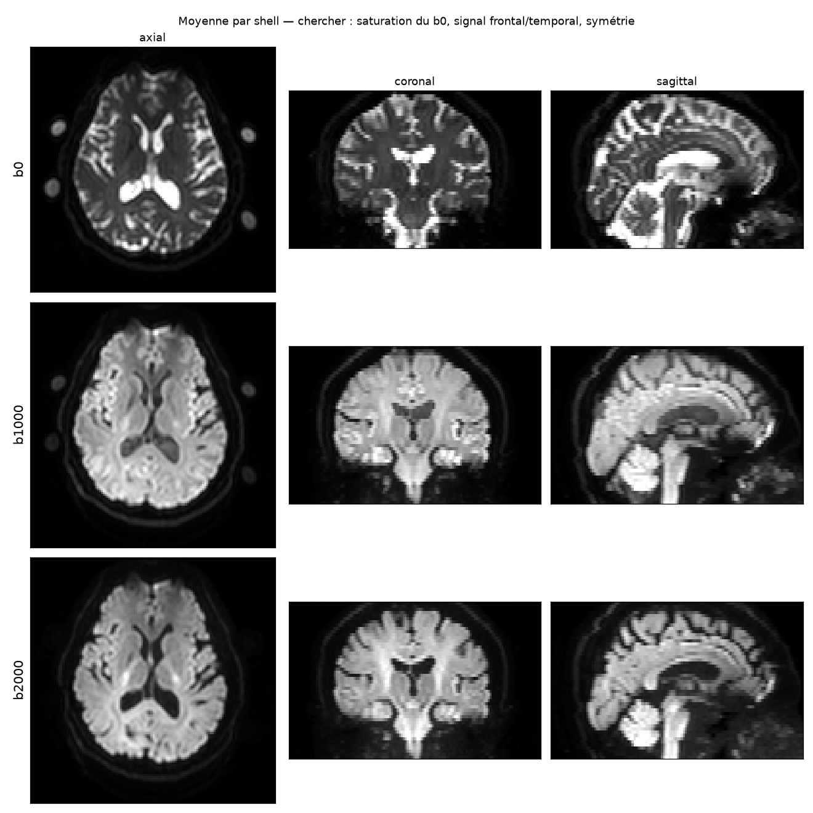

**2. Denoising.** MP-PCA and Gibbs removal. The residual (what was removed) should look like pure noise. If you can see anatomy in it, something is off.

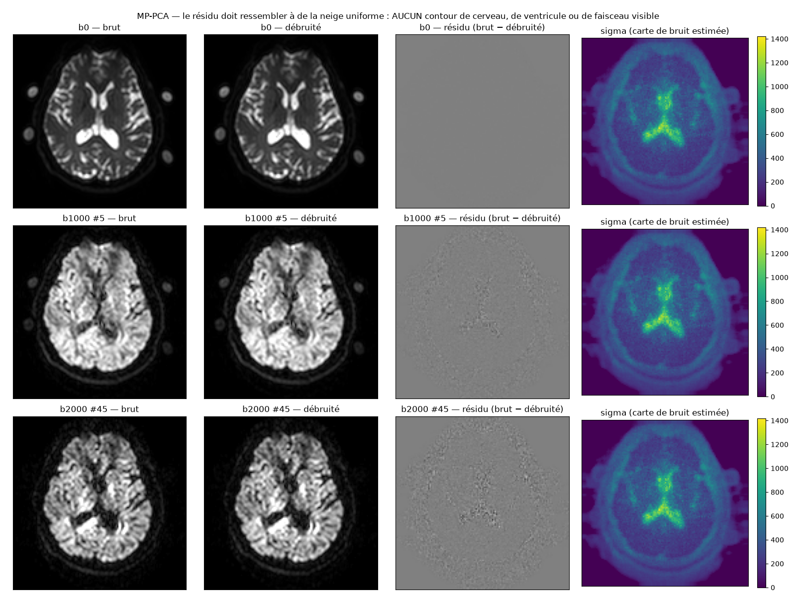

**3. Distortions.** The dataset has no reverse-phase scan, so Synb0-DISCO predicts an undistorted b0 from the T1 and topup uses it. Then eddy corrects motion and eddy currents. Good result = the T1 contour follows the b0 edges.

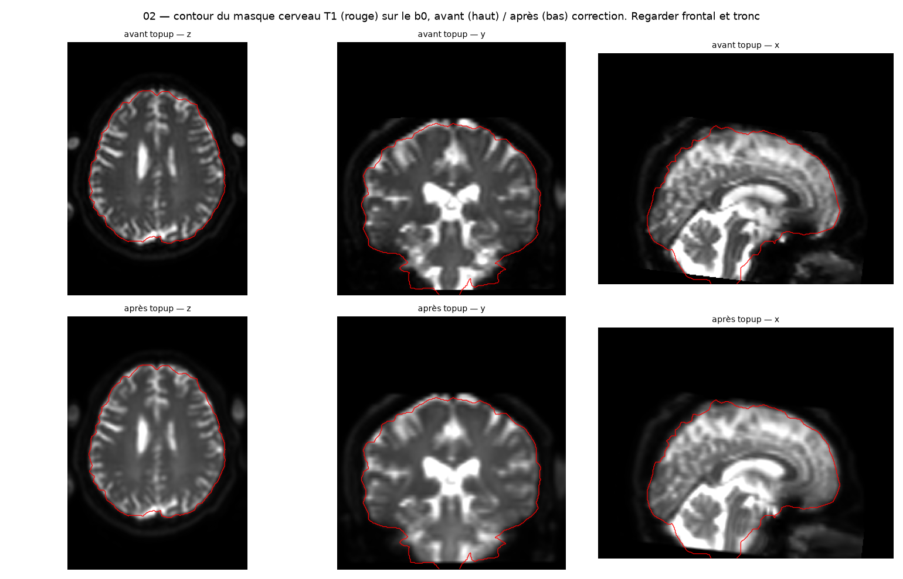

**4. Coregistration.** Rigid registration of the b0 onto the T1 (FLIRT, mutual information). I stay in the patient's native space so the tracts line up with the Lead-DBS electrodes. In a checkerboard, edges must continue across tiles.

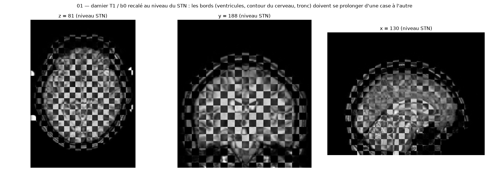

**5. Fibre model.** Multi-shell CSD. Three shells let me separate white matter, grey matter and CSF.

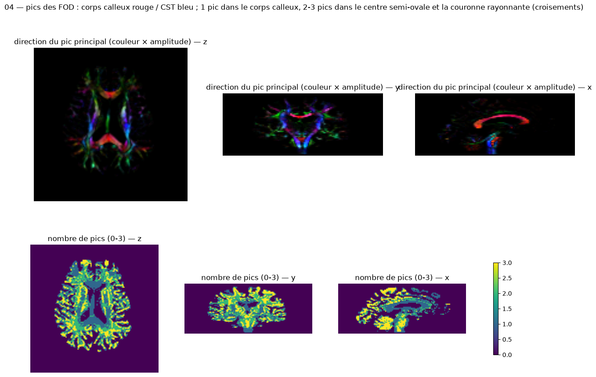

**6. Tissues, with the STN as grey matter.** ACT stops streamlines at the grey/white boundary and the STN is too small to be segmented automatically, so I add it from the authors' atlas as subcortical grey matter. Without that, streamlines go through the STN instead of ending in it.

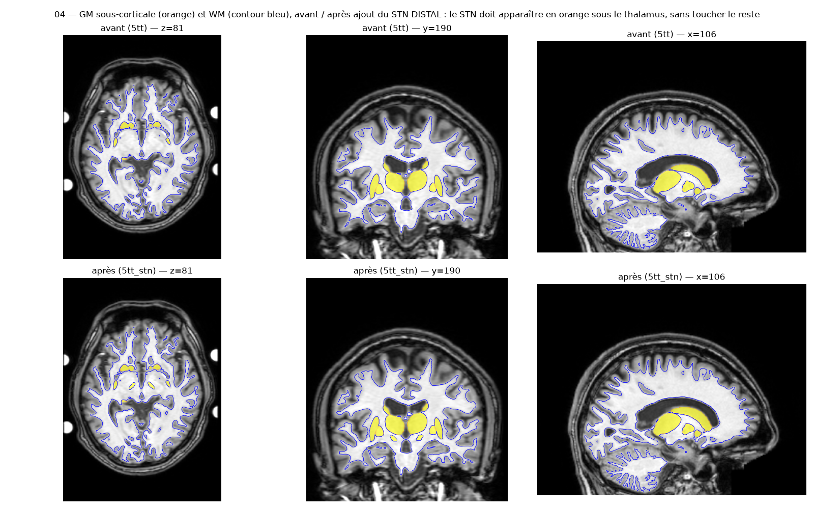

**7. Tractography.** 10 million streamlines (iFOD2 + ACT), weighted with SIFT2.

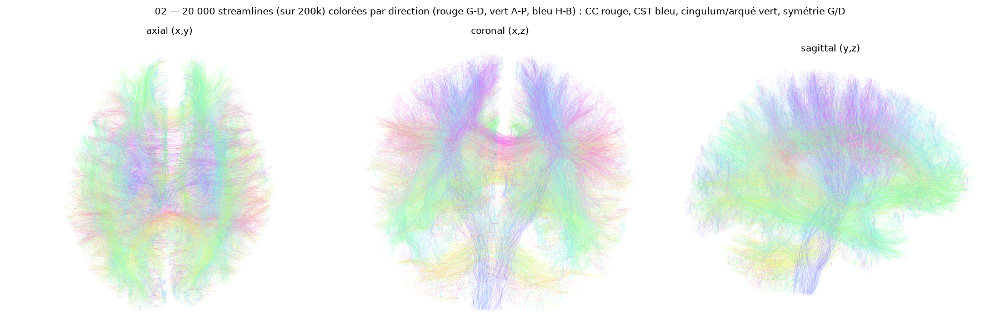

**8. DBS bundles.** Hyperdirect, STN-GPi, corticospinal and the bundles through the VTA. My first definition kept anything that touched the ROIs, which looked wrong by eye, so now both endpoints have to be in the regions.

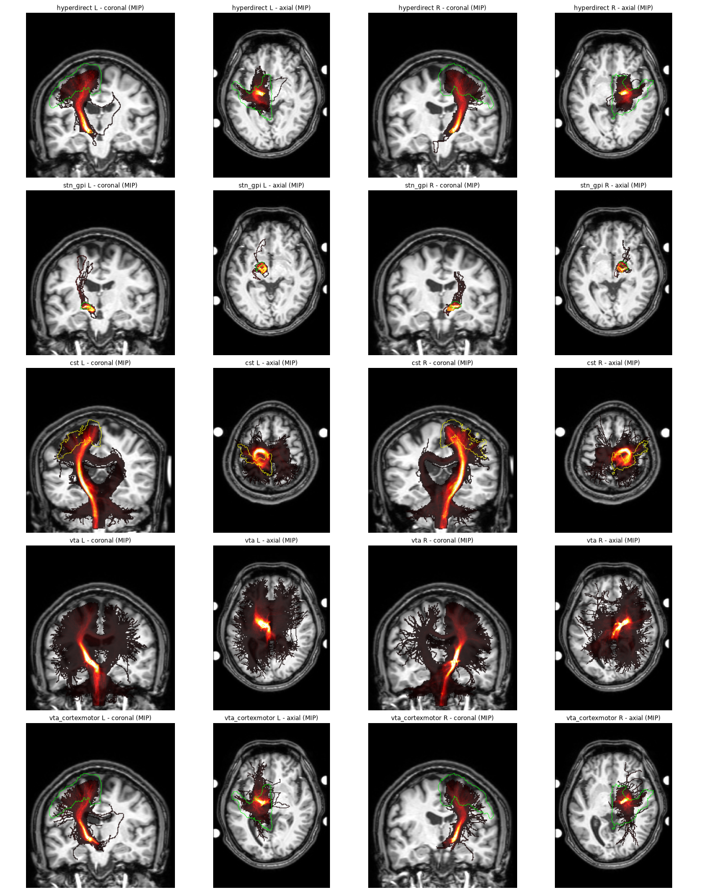

**9. Redoing Lead-DBS.** My PaCER contacts land within about 0.3 mm of the authors'. I didn't correct anything by hand, on purpose: it keeps the pipeline reproducible, but it means a small error is possible. The authors did correct theirs.

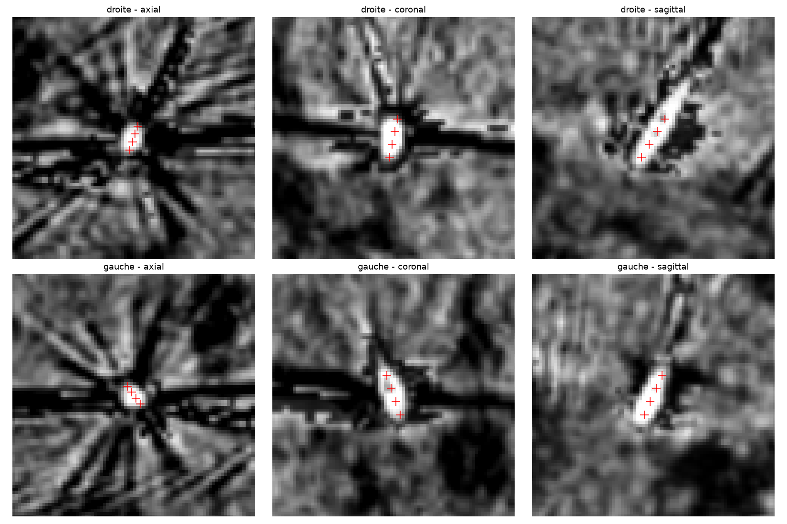

**10. The VTA.** Mine came out about twice too big (red = mine, cyan = authors). The cause was a flipped electrode trajectory in my reconstruction file.

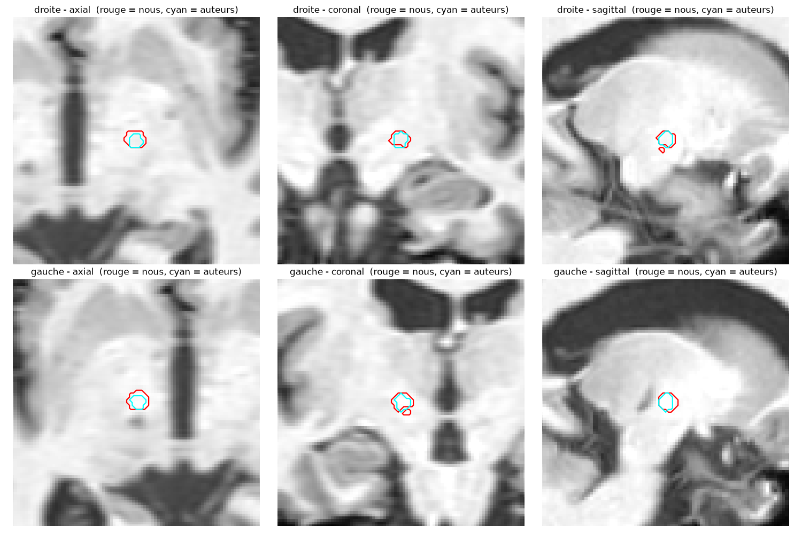

**11. Edge connectome.** For each VTA, the streamlines that go through it are summed between all pairs of the 388 regions. The VTA keeps about 500 of the 75,078 edges.

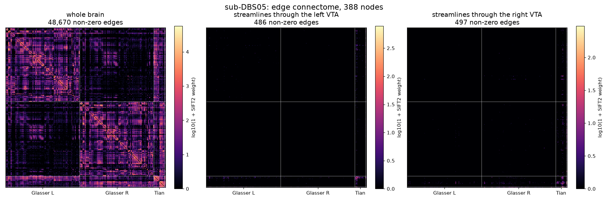

**12. Prediction.** The label is the UPDRS III improvement at 1 month, cut at the median. Leave-one-patient-out found nothing with 9 patients.

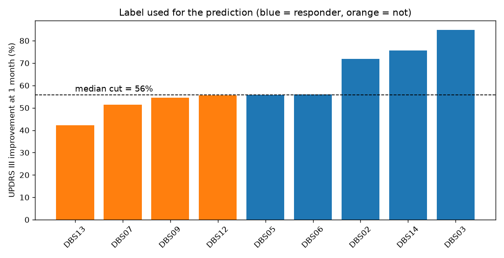

## Requirements

MRtrix3 (3.0.8), FSL (6.0.x), ANTs, Python with numpy, scipy, nibabel, scikit-learn, matplotlib, h5py. Synb0-DISCO either through Docker (`leonyichencai/synb0-disco:v3.1`, needs a FreeSurfer license) or by running inside that image on a Linux GPU machine (the script detects it). The step 07b/09 inputs come from a Lead-DBS reconstruction (see below).

Everything is configured through environment variables, no paths to edit:

```
export PYTHON=/path/to/python      # python with the packages above (default: python3)
export ANTS_BIN=/path/to/ants/bin  # if ANTs is not on PATH
export LEADDBS_DIR=~/opt/leaddbs   # for the MNI template and the Tian atlas (default: ~/opt/leaddbs)
export NTHR=12 EDDY=eddy_openmp    # optional: threads; eddy binary (eddy_cpu on FSL >= 6.0.2)
```

The project root is the folder that contains `scripts/` (override with `ICM=...`).

## Inputs expected per subject

```
data/bids/<sub>/ses-preop/dwi/<sub>_ses-preop_dwi.{nii.gz,bval,bvec,json}   (phase encoding j, TotalReadoutTime in the json)
data/bids/<sub>/ses-preop/anat/<sub>_ses-preop_T1w.nii.gz
data/bids/derivatives/leaddbs/<sub>/   anchor T1 in native space, MNI->native warp,
                                       native atlas (DISTAL STN), stimulation VTA (.nii)
data/atlases/                          parc_mni2009b_1mm.nii.gz  (built once by 11a_build_atlas_mni.py,
                                       needs the Glasser volumetric atlas in MNI)
```

## Running

```
zsh scripts/run_subject.sh sub-01                    # one subject
JOBS=3 zsh scripts/run_cohort.sh sub-01 sub-02 ...   # a cohort, 3 at a time
python scripts/12_build_master.py && python scripts/13_loso_predict.py
```

Outputs go to `derivatives/cohort/<sub>/` (connectomes in `11_edges/`) and `qc_cohort/<sub>/`.

## Using it on another cohort

- Replace the downloader (`10_download_openDBS.py` is specific to the open-DBS FTP).
- If the cohort has no Lead-DBS results, you need to provide the same few things yourself: electrode/VTA in the T1 space, an STN mask, and a warp from MNI to the subject's T1.
- Labels are built in `12_build_master.py` (UPDRS III improvement here). Adapt that part to the new outcome.
- Check the automatic gates in `run_subject.sh` (bvec orientation, STN size) with your acquisition: it assumes phase encoding `j`.

## Layout

- `scripts/`: the pipeline.
- `scripts/server/`: helpers I used to run the cohort on a rented GPU server (kept as an example).
- `scripts/legacy_sub-DBS01/`: the first, step-by-step version and the Lead-DBS reconstruction redo, kept for provenance. Paths in there are specific to my machine. Comments in the scripts are in French, sorry.
- `qc/`: QC figures from the first subject, the one I checked by eye at every step.

No data is included.

## What I got on open-DBS

- 11 of the 14 patients went through (sub-DBS04 and sub-DBS11 have no diffusion data in the dataset). The first subject was run step by step with visual checks, the rest with the automatic checks.
- Tractography and the bundle extraction look plausible at the large-tract level, and the numbers are consistent across patients (SIFT2 mu 1.0-1.3e-4, mean streamline length 35-39 mm).
- The prediction found nothing. With 9 usable patients (18 VTAs) and about 75,000 edges, leave-one-patient-out gives no signal (permutation p = 0.83). The dataset has one stimulation setting per patient, so there is not enough variety to train this kind of model, unlike Presidio. I would not read anything into the exact AUC.
- My Lead-DBS reconstruction redo agrees with the authors' (contacts within about 0.3 mm). My first VTA was about twice too big because of a flipped electrode trajectory in my reconstruction; fixed in a test copy.
